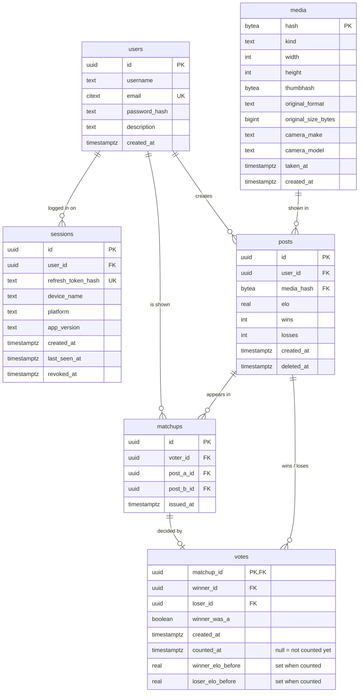

- **Votes are counted later, not when they're cast.** `POST /api/posts/vote` only inserts a `votes` row with `counted_at = null`. It never touches `posts`.
- **The vote counter** (see `ServiceDiagram.md`) applies pending votes in batches. For each vote it fills in `winner_elo_before` / `loser_elo_before`, updates `posts.elo`, `wins` and `losses`, and sets `counted_at`. These columns are only ever written by the counter.
- **`matchup_id` as the primary key** still means one vote per matchup, so a matchup can't be voted on twice.
- **Index:** a partial index `votes (created_at) WHERE counted_at IS NULL` keeps finding pending votes fast, however many counted votes pile up.
- **`posts.elo` is up to one counting interval stale** (about 5 minutes). Rankings and matchups read it as-is.
