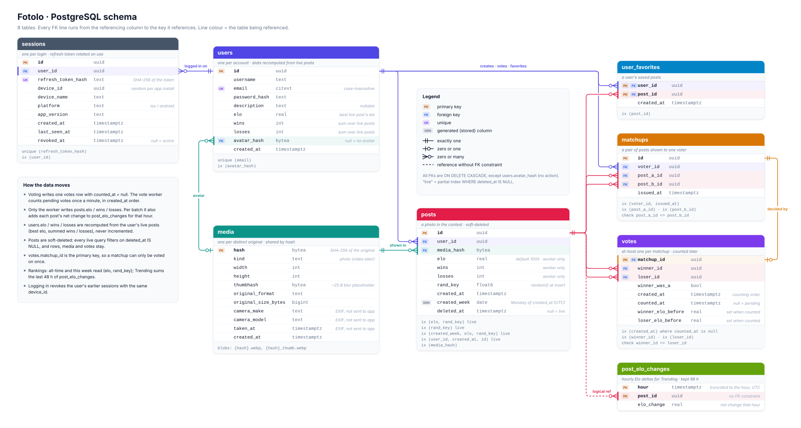
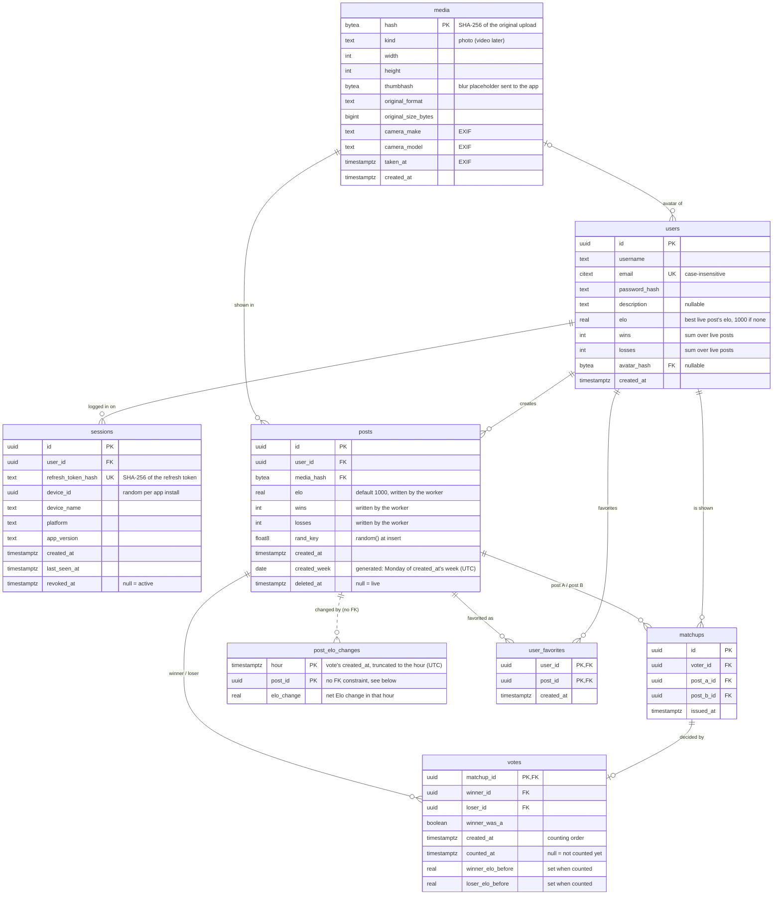

# Database

The picture above is laid out by hand (`diagrams/src/database.py`): every foreign key line starts at the referencing column and ends at the key it references. The Mermaid version below is the same schema, auto-laid-out, and renders directly on GitHub. Rendered copies of it are in `diagrams/mermaid/`.

## How the data moves

- **Votes are counted later, not when they're cast.** `POST /api/Voting/vote` only inserts a `votes` row with `counted_at = null`. It never touches `posts` or `users`.
- **The vote worker** (see `ServiceDiagram.md`) applies pending votes in batches, in `created_at` order. For each vote it fills in `winner_elo_before` / `loser_elo_before` and sets `counted_at`. Per batch it writes each changed post's `elo`, `wins` and `losses` once, and adds each post's net Elo change to its `post_elo_changes` row for that hour. `posts.elo`, `wins` and `losses` are only ever written by the worker.
- **`users.elo`, `wins` and `losses` are recomputed, never incremented.** They are the best `elo` and the summed `wins` / `losses` of the user's live posts, or 1000 / 0 / 0 with no live posts. The worker recomputes them for every user whose posts changed in a batch, and deleting a post recomputes them for its owner. Because each run recomputes from `posts`, a race between the two fixes itself on the next one. The profile reads these columns, so it never has to load every post.
- **Rankings** come in three periods, each as top 10 or worst 10:
  - `all`: every live post, ordered by `(elo, rand_key)`.
  - `week`: live posts with `created_week` = this week's Monday (UTC), on the same ordering. `created_week` is a stored generated column, so the filter and the sort use one index.
  - `trending`: sums the last 48 hours of `post_elo_changes` per live post. The biggest positive totals are rising, the biggest negative ones falling.
- **`post_elo_changes` stays small.** The worker deletes rows older than 96 hours, however many votes there are. `post_id` has no foreign key constraint on purpose: posts are only soft-deleted, the worker only writes ids of posts it just loaded, and a constraint would need an index on `post_id` that every upsert would have to maintain for nothing.
- **`sessions.device_id`** is a random ID the app creates once per install and keeps in SecureStore. Logging in revokes the user's other sessions with the same `device_id`, so two phones with the same device name (every iPhone on iOS 16+ reports just "iPhone") don't log each other out.
- **`matchup_id` as the primary key** means one vote per matchup, so a matchup can't be voted on twice.
- **Posts are soft-deleted.** Deleting a post sets `deleted_at`. The row, its media and its votes stay, and every live query filters on `deleted_at IS NULL`.
- **Media is shared by hash.** The same original uploaded twice is one `media` row, and it can back several posts and avatars.
- **`posts.elo` is up to one counting interval stale** (about a minute). Rankings and matchups read it as-is.
- **Deletes cascade.** Every foreign key is `ON DELETE CASCADE`, except `users.avatar_hash` (no action). Nothing hard-deletes users or posts today, so this only matters for manual cleanup.

## Indexes and constraints

| Table | Index | Used by |
| --- | --- | --- |
| `posts` | `(elo, rand_key) WHERE deleted_at IS NULL` | all-time ranking (top / worst 10), and the ±10 nearby posts for a matchup. `rand_key` breaks ties, so posts with equal Elo still get different neighbours |
| `posts` | `(created_week, elo, rand_key) WHERE deleted_at IS NULL` | this week's ranking (top / worst 10) |
| `posts` | `(rand_key) WHERE deleted_at IS NULL` | picking a random post: first post with `rand_key >= random()` |
| `posts` | `(user_id, created_at, id) WHERE deleted_at IS NULL` | the profile's photos, 30 per page, newest first, paged by `(created_at, id)`; and recomputing a user's stats |
| `post_elo_changes` | primary key `(hour, post_id)` | Trending (a range scan over the last 48 hours), the worker's upsert, and pruning old hours |
| `votes` | `(created_at) WHERE counted_at IS NULL` | the worker finding pending votes, however many counted votes pile up |
| `matchups` | `(voter_id, issued_at)` | finding a voter's latest open matchup |
| `user_favorites` | `(post_id)` | "who favorited this post" (the primary key covers lookups by user) |
| `users` | `email` unique (`citext`, case-insensitive) | login and register |
| `sessions` | `refresh_token_hash` unique | refresh |
| all | one plain index per FK column: `sessions.user_id`, `posts.media_hash`, `users.avatar_hash`, `matchups.post_a_id` / `post_b_id`, `votes.winner_id` / `loser_id` | EF Core adds these by default. They keep joins and cascades from scanning |

Check constraints: `matchups.post_a_id <> post_b_id` and `votes.winner_id <> loser_id`.
