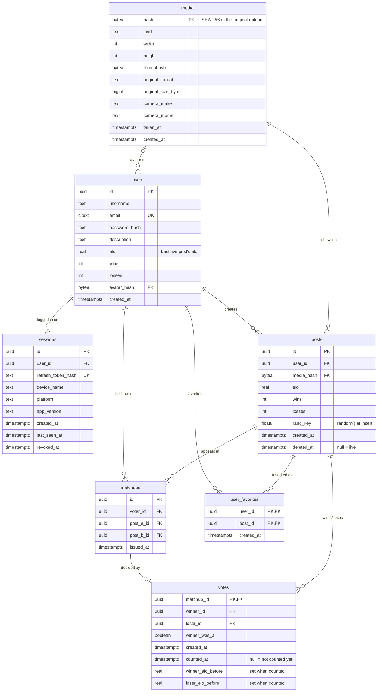

- **Votes are counted later, not when they're cast.** `POST /api/posts/vote` only inserts a `votes` row with `counted_at = null`. It never touches `posts` or `users`.
- **The vote worker** (see `ServiceDiagram.md`) applies pending votes in batches. For each vote it fills in `winner_elo_before` / `loser_elo_before` and sets `counted_at`. Per batch it writes each changed post's `elo`, `wins` and `losses` once, adds the batch's wins and losses to `users`, and sets `users.elo` to the user's best live post. These columns are only ever written by the worker.
- **`matchup_id` as the primary key** means one vote per matchup, so a matchup can't be voted on twice.
- **Posts are soft-deleted.** Deleting a post sets `deleted_at`. The row, its media and its votes stay, and every live query filters on `deleted_at IS NULL`.
- **Media is shared by hash.** The same original uploaded twice is one `media` row, and it can back several posts and avatars.
- **`posts.elo` is up to one counting interval stale** (about a minute). Rankings and matchups read it as-is.

## Indexes and constraints

| Table | Index | Used by |
| --- | --- | --- |
| `posts` | `(elo, rand_key) WHERE deleted_at IS NULL` | ranking (top / worst 10), and the ±10 nearby posts for a matchup. `rand_key` breaks ties, so posts with equal Elo still get different neighbours |
| `posts` | `(rand_key) WHERE deleted_at IS NULL` | picking a random post: first post with `rand_key >= random()` |
| `votes` | `(created_at) WHERE counted_at IS NULL` | the worker finding pending votes, however many counted votes pile up |
| `matchups` | `(voter_id, issued_at)` | finding a voter's latest open matchup |
| `user_favorites` | `(post_id)` | "who favorited this post" (the primary key covers lookups by user) |
| `users` | `email` unique (`citext`, case-insensitive) | login and register |
| `sessions` | `refresh_token_hash` unique | refresh |

Check constraints: `matchups.post_a_id <> post_b_id` and `votes.winner_id <> loser_id`.
