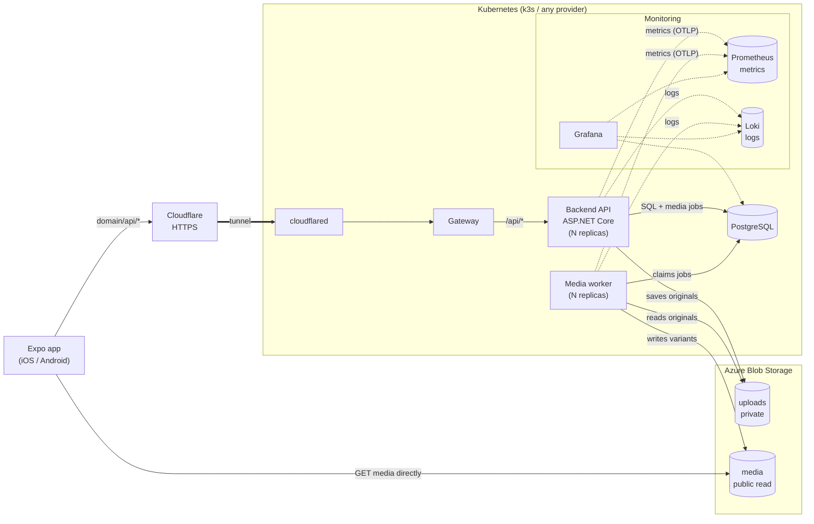
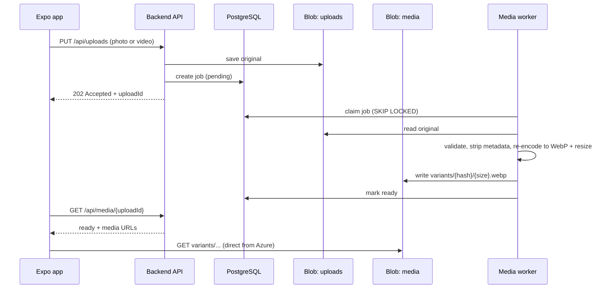

## Services

- **Backend and worker are stateless**, so they scale by adding replicas. All state lives in Postgres and Azure Blob Storage.
- **Azure Blob Storage** holds all media in two containers:
  - `uploads` is private and holds the originals with metadata intact. Only the backend and worker can access it. A lifecycle rule deletes originals N days after processing.
  - `media` allows anonymous blob-level read, so blobs can be fetched by exact path but the container can't be listed. It holds the processed variants.
- **The app fetches media directly from Azure.** Media never goes through the cluster. The DB stores blob keys (`variants/{hash}/{size}.webp`), not full URLs. The API builds URLs from a `MediaBaseUrl` config value (`https://<account>.blob.core.windows.net/media`).
- **Variants are content-addressed and immutable.** They are written with `Cache-Control: public, max-age=31536000, immutable`, so the app can cache them forever.
- **Credentials:** the backend and worker authenticate with a connection string stored as a Kubernetes Secret. The app never holds storage credentials.
- **Postgres** runs as a container (CloudNativePG in Kubernetes). Keep each pod's connection pool small (`Max Pool Size`) so replicas × pool stays under Postgres' connection limit.
- **Monitoring:** the backend and worker push logs to Loki and metrics to Prometheus over OTLP. Grafana shows both, plus app data queried straight from Postgres. It isn't exposed publicly.
- **Local development** runs the same images under `docker compose`, with Azurite (the Azure Storage emulator) standing in for Blob Storage. Only the connection string and `MediaBaseUrl` differ.

## Media upload flow

