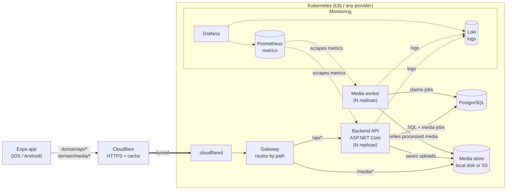
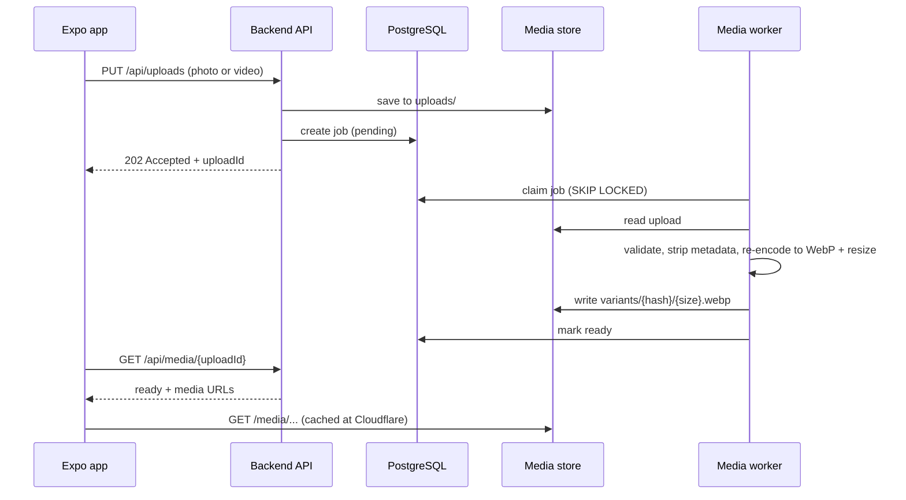

## Services

- **Backend and worker are stateless**, so they scale by adding replicas. All state lives in Postgres and the media store.
- **Media store** sits behind one interface in the backend: local disk to start, any S3-compatible storage later, chosen by config. With local disk, a small nginx serves `/media/*` and everything runs on one node.
- **Postgres** runs as a container (CloudNativePG in Kubernetes). Keep each pod's connection pool small (`Max Pool Size`) so replicas × pool stays under Postgres' connection limit.
- **Monitoring:** logs go to Loki, Prometheus collects metrics, and Grafana shows both. It isn't exposed publicly.
- The same images run under `docker compose` for local development.

## Media upload flow

