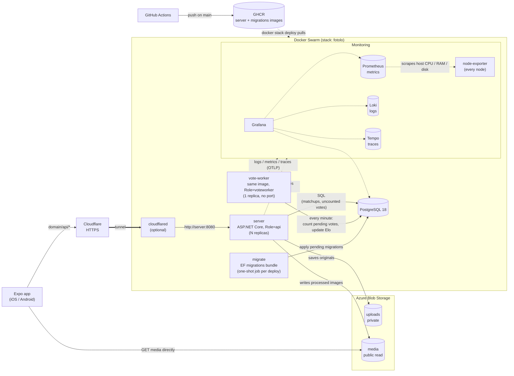
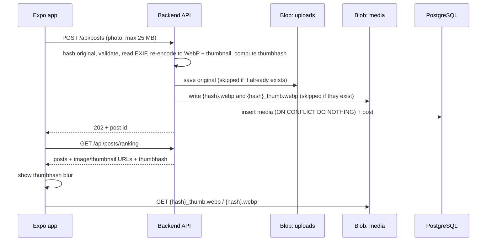
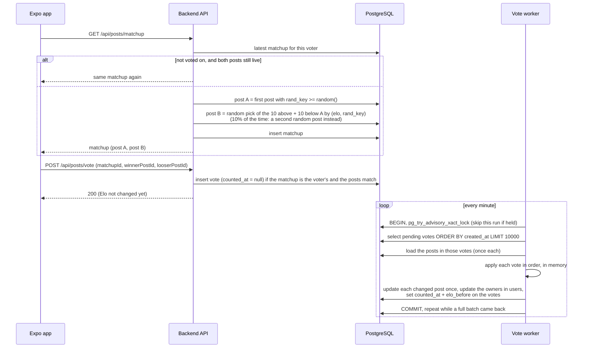

## Services

- **Deployment:** everything runs as one Docker Swarm stack, defined in `swarm/docker-compose.yml`. On every push to `main`, CI builds the `server` and `migrations` images for amd64 and arm64 and pushes them to GHCR. `docker stack deploy` pulls them. Stateful services (Postgres, Loki, Prometheus, Tempo, Grafana) are pinned to the manager node, because their volumes are local to it.
- **No gateway.** cloudflared forwards to `http://server:8080`, and Swarm's routing mesh load-balances across the replicas. The backend sets its own upload limit (25 MB). Cloudflare's free plan caps request bodies at 100 MB.
- **The backend is stateless**, so it scales by adding replicas (`SERVER_REPLICAS`). All state lives in Postgres and Azure Blob Storage. The one exception is rate limiting, which is counted in memory on each replica.
- **The vote worker** is the same Docker image as the backend, started with `--Role=voteworker`. In that mode it runs one `BackgroundService` and maps no API endpoints. It's its own service with exactly 1 replica, no published port, and `stop-first` updates, so two workers never overlap during a deploy. The API replicas never write Elo. See [Vote counting flow](#vote-counting-flow).
- **Migrations** run as a Swarm `replicated-job` on every deploy. Swarm ignores `depends_on`, so the job retries until Postgres is up, and the server and worker restart until the schema exists. Locally there is no migrate job: run `dotnet ef database update` in `Server/`.
- **Photos only for now.** `media.kind` stays so video can be added later, but nothing handles video yet.
- **Uploads are processed inline** in the request: the backend validates the image (max 50 megapixels), bakes in the EXIF orientation, resizes it and re-encodes it to WebP. The processed images carry no metadata. Avatars go through the same pipeline.
- **EXIF data** (camera make/model, capture time) is saved in the `media` table but never returned by the API. It's there in case the app shows it later.
- **Azure Blob Storage** has two containers. Blobs are named by the SHA-256 of the original upload, so re-uploading the same file reuses the existing blobs.
  - `uploads` is private and holds the original file, metadata intact. Only the backend can access it.
  - `media` allows anonymous blob-level read, so blobs can be fetched by exact name but the container can't be listed. Each image is stored twice: `{hash}.webp` (max 2048 px) and `{hash}_thumb.webp` (max 400 px).
- **The app fetches media directly from Azure.** Media never goes through the stack. The DB stores only the hash, and the API builds the URLs.
- **Thumbhash placeholders:** each upload also gets a [ThumbHash](https://evanw.github.io/thumbhash/), a ~25-byte encoding of a blurred version of the image, stored in `media.thumbhash`. The API sends it (base64) with every post, and the app shows it as a blur until the thumbnail has loaded.
- **Credentials:** the backend authenticates to Azure with a connection string (`ConnectionStrings:Blobs`). The app never holds storage credentials.
- **Postgres** runs as a single container with a volume on the manager node.
- **Monitoring:** the backend and the worker push logs to Loki, metrics to Prometheus and traces to Tempo, all over OTLP. node-exporter runs on every node and Prometheus scrapes it for host CPU, RAM and disk. Grafana shows all of it, plus app data queried straight from Postgres, and loads the `Fotolo overview` dashboard from `swarm/grafana-dashboard.json` on startup. Its port should be firewalled or reached over an SSH tunnel.
- **Local development** runs only the infrastructure in Docker (`docker-compose.infra.yml`: Postgres, Loki, Prometheus, Tempo, Grafana) and the backend with `dotnet run`. It points at a real Azure storage account. There is no local emulator.

## Media upload flow

## Vote counting flow

- **Matchups:** the voter never gets their own posts. Picking post B near post A by Elo keeps matchups close, and the occasional fully random post B lets new or badly placed posts move fast. Every step is a small query on an index (see `DatabaseDiagram.md`), so a matchup costs the same however many posts there are.
- **Why the votes are counted in one place:** Elo depends on the order votes are applied. With one worker the result is the same as counting each vote live, and API replicas never race each other updating the same post row.
- **Smart batching:** a post that appears in 50 pending votes is read once and written once per batch, not 50 times. Votes are still applied one by one in `created_at` order, so the Elo math is exact.
- **Safe to restart or double-start:** each batch is one transaction, so a crash just leaves those votes pending for the next run. The advisory lock means a second worker would skip the run instead of counting twice.
- **Deleted posts:** a vote on a post that was deleted before counting is counted like any other. The deleted post's Elo changes, but it no longer appears in rankings or matchups.
- **The interval is fixed at one minute** (`PollInterval` in `VoteWorker.cs`). Shorter means fresher rankings and smaller batches.
