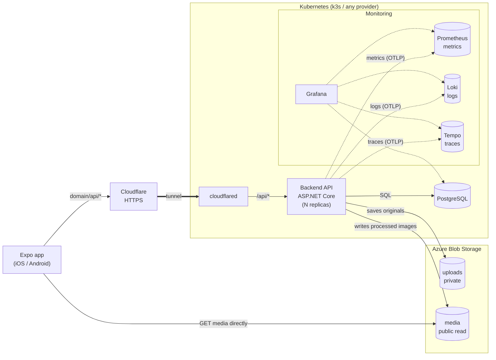
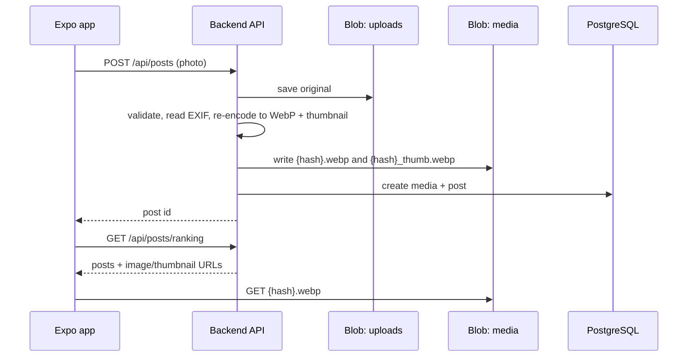

## Services

- **No gateway.** cloudflared routes `/api/*` straight to the backend's Kubernetes Service, which load-balances across replicas. The backend sets its own upload size limit. Cloudflare's free plan caps request bodies at 100 MB.
- **The backend is stateless**, so it scales by adding replicas. All state lives in Postgres and Azure Blob Storage.
- **Photos only for now.** `media.kind` stays so video can be added later, but nothing handles video yet.
- **Uploads are processed inline** in the request: the backend validates the image, bakes in the EXIF orientation, resizes it and re-encodes it to WebP. The processed images carry no metadata.
- **EXIF data** (camera make/model, capture time) is saved in the `media` table but never returned by the API. It's there in case the app shows it later.
- **Azure Blob Storage** has two containers:
  - `uploads` is private and holds the original file, metadata intact. Only the backend can access it.
  - `media` allows anonymous blob-level read, so blobs can be fetched by exact name but the container can't be listed. Each image is stored twice, named by the SHA-256 of the encoded image: `{hash}.webp` (max 2048 px) and `{hash}_thumb.webp` (max 400 px).
- **The app fetches media directly from Azure.** Media never goes through the cluster. The DB stores only the hash, and the API builds the URLs.
- **Credentials:** the backend authenticates with a connection string (`ConnectionStrings:Blobs`). The app never holds storage credentials.
- **Postgres** runs as a container (CloudNativePG in Kubernetes). Keep each pod's connection pool small (`Max Pool Size`) so replicas × pool stays under Postgres' connection limit.
- **Monitoring:** the backend pushes logs to Loki, metrics to Prometheus and traces to Tempo, all over OTLP. Grafana shows all three, plus app data queried straight from Postgres. It isn't exposed publicly.
- **Local development** runs the same images under `docker compose`, pointed at a real Azure storage account. There is no local emulator.

## Media upload flow

